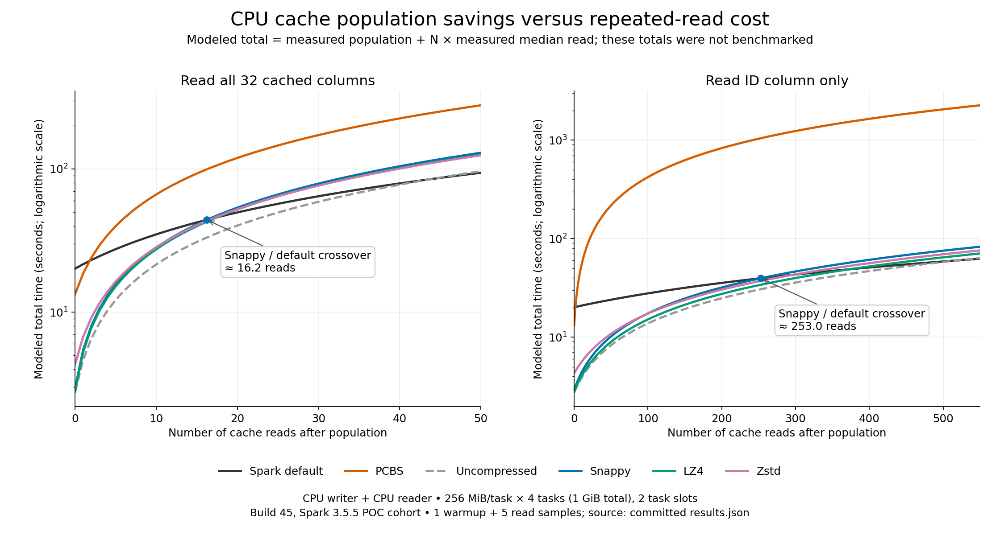

# Explore a shared CPU/GPU packed-column cache with general-purpose compression

Draft performance issue; proof of concept, ready for human review. AI assistance
was used for implementation, analysis and this draft. No issue has been filed.

A cache format based on small packed column records and general-purpose
compression offers a promising alternative to Parquet for CPU fallback. The
experiment is an actual Spark cache serializer, including Spark row-to-columnar
conversion, cache population, reuse reads, projection and statistics pruning.
It is not just a compression microbenchmark.

CPU population reuses Spark ArrowWriter, packs the resulting columns and
compresses independent chunks with reusable task-owned codec contexts. GPU
population uses cuDF contiguous packing and batched compression; many independent
chunks are submitted together. A record's directory identifies separately
compressed columns so a projection can decode only selected columns. The cache
uses one byte array with a column directory, not separate files per column.
Small stored records are grouped toward the requested GPU output target.

CPU/GPU interoperability is verified for uncompressed, Snappy, LZ4 and Zstd.
ANS and the installed legacy Cascaded codec are GPU-only; unsupported CPU paths
throw. The upcoming redesigned Cascaded implementation was not measured.

## CPU fallback: population and reads are different tradeoffs

The current matched cohort uses 256 MiB logical data per task, four tasks/two
waves (1 GiB total), 32 cached numeric fields, and local[2]. Times are seconds;
reads are five-sample medians after one warmup. Population is one first cache
action, including upstream generation and row conversion, not isolated encode.
Encoded size is the whole cache's payload, including format framing/metadata;
default Spark's separate statistics row is excluded.

| CPU writer / CPU reader | Population s | Full read s | ID-only read s | Encoded MiB |
| --- | ---: | ---: | ---: | ---: |
| Default Spark | 20.118 | 1.479 | 0.077 | 415.7 |
| PCBS | 13.297 | 5.305 | 4.083 | 701.2 |
| Packed uncompressed | 2.754 | 1.874 | 0.110 | 1024.1 |
| Packed Snappy | 2.912 | 2.538 | 0.145 | 516.9 |
| Packed LZ4 | 2.777 | 2.468 | 0.123 | 506.0 |
| Packed Zstd | 4.301 | 2.406 | 0.130 | 393.4 |

Snappy population is about 6.9× faster than default Spark and 4.6× faster than
PCBS. Its CPU full read is about 2.1× faster than PCBS and projected read about
28× faster. Default Spark remains the faster CPU reader. PCBS CPU-written pages
use UNCOMPRESSED Parquet plus Parquet encoding; the GPU writer uses Snappy.
These comparisons include conversion and format differences, not just codec speed.

The decision depends on reuse. Model total time as:

`T(N) = population + N × read`

N counts additional reuse reads after the population action; that initial action
is already included in population. For formats A and B the crossing is
`N = (P_B - P_A) / (R_A - R_B)` when positive. Full and projected workloads need
separate curves. For mixed reads use the measured workload's weighted read cost.
These are modeled totals from measured phases, not independently measured long
runs; the decimal crossover is approximate and has no confidence interval.

| Packed format vs default, CPU-written/CPU-read | Full-read crossover N | Default faster starting at reuse read | ID-only crossover N | Default faster starting at reuse read |
| --- | ---: | ---: | ---: | ---: |
| Uncompressed | 43.87 | 44 | 522.48 | 523 |
| Snappy | 16.24 | 17 | 252.99 | 253 |
| LZ4 | 17.53 | 18 | 373.26 | 374 |
| Zstd | 17.05 | 18 | 297.92 | 298 |

Below each crossing, packed has lower modeled total time; above it, default wins.
All four packed formats beat PCBS on both CPU population and these CPU reads,
so there is no positive crossover against PCBS. Memory residency, compressed
size, pruning and rebuild frequency can change the practical choice.

## GPU performance and size at task scale

These are GPU-written caches and GPU-requested queries: four tasks/two waves,
2 GiB logical input per task (8 GiB total), 1 GiB GPU output target. This supplement
did not run CPU population or CPU-query reads. Default Spark's cache encoder
and decoder remain CPU paths even when GPU execution is requested.

| Format | Population s | GPU-mode full read s | GPU-mode ID read s | Encoded MiB |
| --- | ---: | ---: | ---: | ---: |
| Default Spark | 156.765 | 4.802 | 0.437 | 3325.6 |
| PCBS | 4.426 | 1.043 | 0.484 | 3917.4 |
| Packed Snappy | 4.505 | 1.293 | 0.201 | 4166.3 |
| Packed LZ4 | 4.830 | 1.391 | 0.217 | 4055.9 |
| Packed Zstd | 5.847 | 1.228 | 0.197 | 3020.2 |
| Packed ANS | 4.138 | 1.575 | 0.228 | 4517.9 |
| Packed Cascaded | 4.859 | 1.885 | 0.216 | 3138.7 |

Snappy GPU population is within about 2% of PCBS in this cohort. PCBS is faster
for full GPU reads; packed projection is substantially faster. Zstd retains about
23% fewer payload bytes than PCBS, with about 18% slower full GPU reads. This
supports exploring a common CPU/GPU format, rather than claiming every packed
codec wins every operation. GPU-uncompressed at 2 GiB/task remains excluded after
a previously reproduced Java heap allocation failure; no successful rerun is claimed.

For GPU full reads, PCBS beats Snappy/LZ4/Zstd/Cascaded on both population and
reads in this supplement. ANS has lower population but slower full reads, so its
advantage disappears before the first reuse read. For ID-only reuse, Snappy's
small population penalty is recovered on the first read; LZ4/Cascaded by the
second and Zstd by the fifth. Exact values can be recalculated from results.json.

## Pruning and limits

The POC stores exact min/max/null statistics and reuses Spark's cache-statistics
filter with conservative guards. Residual filters still run. The high-quarter
predicate avoided 75% of selected nvCOMP decoded packed bytes; no-match avoided
all selected payload decoding. Paired full-read medians at 2 GiB/task are:

| Format | High-quarter pruning OFF → ON s | No-match OFF → ON s |
| --- | ---: | ---: |
| PCBS | 0.958 → 0.581 | 0.973 → 0.211 |
| Packed Snappy | 1.213 → 0.539 | 1.116 → 0.208 |
| Packed LZ4 | 1.122 → 0.488 | 1.219 → 0.192 |
| Packed Zstd | 1.066 → 0.480 | 0.996 → 0.169 |

All-match controls and full precision are in results.json. Codec-call counters
are not physical kernel counts, and byte counters are not independent PCIe traces.

The supported POC types are flat int/long/default-binary strings; large strings,
other types, CPU columnar input, spill recovery and production compatibility are
not established. All successful runs kept four partitions resident, with no
observed disk/recomputation and zero available spill/retry counters. Missing
CPU counters mean unavailable, not zero. This was not a memory-exhaustion test.

Settings: 16 GiB JVM heap, 32 GiB managed host including 2 GiB pinned, 24 GiB RMM
limit, 64 GiB sampled process-tree RSS stop guard. The guard is not a hard OS
memory limit. Largest whole-job sampled RSS was 19.830 GiB, tracked RMM highwater
12.049 GiB; neither is a serializer-only working set.

The local Spark 3.5.5 distribution contains instrumentation. Compression stream
tracing was disabled, but these are not claimed stock-Spark results. The numeric
fixture is useful for controlled comparison, not sufficient for workload-wide
codec selection. Timing build45 predates final invalid-UTF8 guards; final build46
validated the corrected implementation separately. See [handoff](README.md).

Next work should broaden schemas and workloads, profile the remaining CPU
read cost, and make the build portable before production integration. All required
patches for this experiment are in the plugin repository; Vortex is outside this issue.
