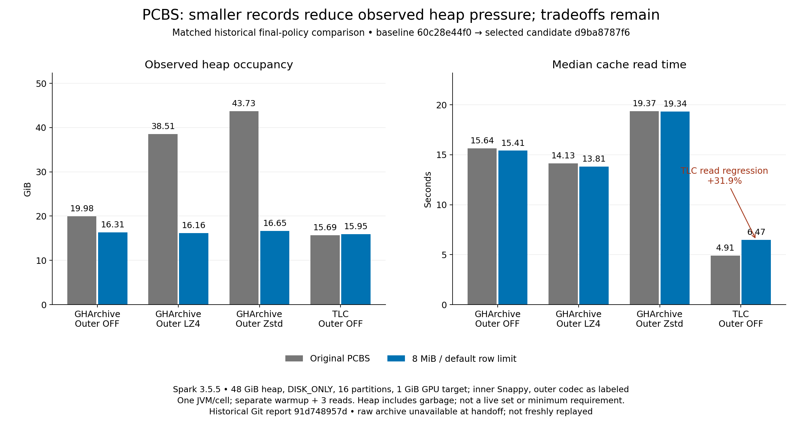

# Reduce Parquet cache heap pressure while preserving large GPU read batches

Draft performance issue; proof of concept, ready for human review. AI assistance
was used for implementation, analysis and this draft. No issue has been filed.

PCBS can put very large encoded Parquet arrays into Spark's cache. Spark's
count-based unroll checks and Java serialization reset interval can retain many
bytes before their next check. Reducing the GPU target to avoid that pressure
also reduces GPU processing efficiency. This branch separates the stored record
size from the decoded GPU batch target.

The implementation targets approximately 8 MiB of uncompressed row-group data,
extracts independent Parquet records without decoding/reencoding column chunks,
and materializes those records lazily from spillable staging. The GPU reader
bundles records toward the configured output target using encoded and estimated
decoded sizes. It presents column-chunk views and a rewritten footer to the
chunked reader, avoiding another complete encoded-payload concatenation.
The byte target is soft; it is not a hard bound on encoded arrays or peak memory.

This remains Parquet: columns already have independent chunks within each file.
We did not replace PCBS with one file per column. Existing record and decoder
contracts are preserved, including reading older multi-row-group records.

## Matched measurements of the selected policy

These are historical, previously verified measurements recovered from the Git
report `91d748957d:docs/dev/pcbs-rowgroup-production-results.md`. The original raw
archive `/data/pcbs-oom/pcbs-rowgroup-production` is unavailable in this sandbox
at handoff; these results have not been freshly replayed. Preserve that status
when posting or restore the archive for independent reproduction.

Baseline `60c28e44f0`; selected 8 MiB/default-row candidate `d9ba8787f6`, recorded
as behaviorally equivalent to policy `fa29f4d90c`. These are not timings of the
later predicate-pruning additions or current HEAD.

Each cell compares before → after. Spark 3.5.5, sixteen fixed partitions, eight
local slots, two concurrent GPU tasks, 48 GiB JVM heap, DISK_ONLY, 1 GiB GPU output
target, 15 GiB GPU pool, 40 GiB managed host budget, 2 GiB pinned pool, inner
Snappy, default reset100/unroll16. One fresh JVM per arm; separate warmup and
median of three reuse reads. Outer compression affects additional Spark paths,
so those rows are full-query comparisons, not isolated codec costs.

| Dataset / outer compression | Population s | Read s | Observed heap GiB | Parquet payload GiB |
| --- | ---: | ---: | ---: | ---: |
| GHArchive / OFF | 48.721 → 46.500 | 15.645 → 15.407 | 19.984 → 16.311 | 23.512 → 23.336 |
| GHArchive / LZ4 | 54.949 → 52.193 | 14.131 → 13.808 | 38.505 → 16.157 | 23.512 → 23.336 |
| GHArchive / Zstd | 70.013 → 67.309 | 19.373 → 19.337 | 43.734 → 16.651 | 23.512 → 23.336 |
| TLC / OFF | 18.625 → 18.137 | 4.905 → 6.468 | 15.685 → 15.950 | 5.755 → 6.265 |

GHArchive has 32,078,549 rows; TLC has 239,470,448. Heap is sampled phase occupancy,
including garbage, not a minimum required heap or isolated serializer live set.
The result is workload-dependent: GHArchive benefits, while TLC reads regress
and its encoded payload grows about 8.9%. These are not independent-run confidence
intervals or evidence of a universal throughput improvement.

For a time-based comparison, use `T(N) = population + N × read`, with N additional
reuse reads per population. In the TLC/OFF pair the new layout saves 0.488 s of
population but adds 1.563 s per read: the crossover is about 0.31 reads per
population, so the old layout wins from the first reuse read. In the three
GHArchive rows above, the new layout has both lower population and read times.
These modeled totals do not override memory feasibility or encoded-size costs.

## Why the memory change is useful

An earlier repeated synthetic cohort, explicitly a different 8 MiB/65,536-row-cap
implementation (`c385525a51`), provides the strongest repeated OOM evidence:
96 GiB of semantic values, sixteen partitions, 48 GiB heap, default Spark reset
and unroll settings. Original PCBS failed MEMORY_AND_DISK readback in all three
fresh JVMs; the patch passed all three. Stored records changed from 112 to 12,400;
the largest encoded record changed from 895.936 MiB to 7.938 MiB. A separate
batch-layout diagnostic returned **112 GPU batches in both implementations**.
This demonstrates the intended separation, not final-policy batch counts.

The later final-policy GHArchive 8 GiB-heap screen passed with the 8 MiB target:
DISK_ONLY population/read 43.331/15.296 s, observed heap 3.002 GiB;
MEMORY_AND_DISK 46.242/15.099 s, observed heap 6.584 GiB. Both stored 11,722
records. That screen had no matched original-baseline arm; do not present its
read times as a new matched comparison to the older OOM case.

## Additional pruning proof

The POC also connects the GPU cache scan to the serializer's batch filter and
reuses Spark ParquetFilters plus Parquet RowGroupFilter for conservative
footer-statistics pruning. Residual Spark filters still run. Unknown predicates
retain records, and lossy UTF-8 literals have a conservative guard.

In the newer, separate 2 GiB/task numeric cohort, matched same-predicate GPU
full-read medians with pruning OFF → ON are:

| Predicate | PCBS read s |
| --- | ---: |
| All rows match | 1.014 → 1.047 |
| Highest quarter | 0.958 → 0.581 |
| No rows match | 0.973 → 0.211 |

Separate actual scan metrics confirm skipping for all four CPU/GPU writer/reader
combinations. These later measurements are not baseline-to-row-group speedups.
The local Spark runtime is instrumented, with compression tracing disabled;
they are not claimed measurements on an unmodified stock distribution.

## Proposed follow-through

Review storage granularity, ownership/retry behavior and performance tradeoffs
before production adoption. Keep the stored-record target independent of the GPU
output target, and preserve Parquet's existing column pruning. Include broad
schemas and workload-specific regressions in subsequent acceptance work.

All implementation patches are in the RAPIDS plugin repository. Cross-version
acceptance remains incomplete; this branch is a local Spark 3.5.5 proof of concept.
See [handoff and provenance](README.md) and [machine-readable results](results.json).
