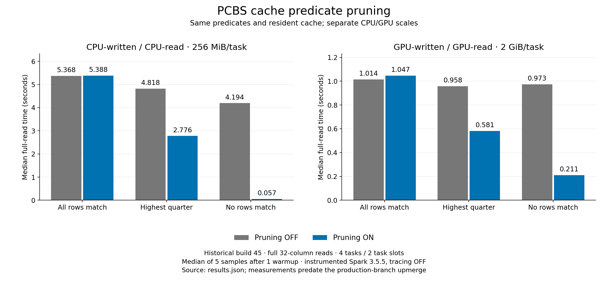

# Add predicate pruning to Parquet cached batches on CPU and GPU

This proof of concept explores faster Spark caching through PCBS predicate
pruning and [compressed batches shared by CPU and GPU execution](issue-packed-cache.md).

PCBS now implements Spark's cache `buildFilter` using Parquet footer statistics,
Spark ParquetFilters and Parquet RowGroupFilter. GPU cache scans invoke the same
hook already used by CPU scans. Records that cannot match are skipped before
decoding; residual filters still run. Unsupported predicates retain records,
with conservative guards for lossy UTF-8 literals.

## Read performance

Same cache and predicate, pruning OFF → ON. Times are seconds, medians of five
reads after one warmup. Four tasks/two waves, 32 numeric columns, full-column
reads; the high-quarter predicate selects the highest quarter of IDs.

| MiB/task | Writer | Reader | All match | High quarter | No match |
| --- | --- | --- | ---: | ---: | ---: |
| 256 | CPU | CPU | 5.368 → 5.388 | 4.818 → 2.776 | 4.194 → 0.057 |
| 256 | CPU | GPU | 0.203 → 0.207 | 0.266 → 0.202 | 0.262 → 0.170 |
| 256 | GPU | CPU | 5.047 → 5.060 | 4.550 → 2.562 | 4.022 → 0.074 |
| 256 | GPU | GPU | 0.214 → 0.214 | 0.196 → 0.149 | 0.195 → 0.103 |
| 2048 | GPU | GPU | 1.014 → 1.047 | 0.958 → 0.581 | 0.973 → 0.211 |

Pruning helps selective reads, particularly CPU scans. Separate scan metrics
confirm skipping in all four writer/reader combinations while preserving query
results. CPU-written
PCBS uses uncompressed Parquet pages with Parquet encoding; GPU-written PCBS
uses Snappy.

Settings: Spark 3.5.5, local[2], 1 GiB GPU output target, 16 GiB heap, 32 GiB
managed host including 2 GiB pinned, 24 GiB RMM, 64 GiB sampled RSS stop guard.
The 2 GiB/task supplement ran GPU population/reads only.

## Scope and evidence

Initial support covers flat int/long/default-binary strings. Existing Parquet
pushdown controls and Spark's cache-pruning gate are honored. Legacy records
with multiple row groups are kept if any group can match.

These are build45 measurements from before the upmerge, on an instrumented Spark
runtime with compression tracing disabled. Final UTF-8 guard correctness was
validated separately in build46; cross-version acceptance remains incomplete.
The POC builds on small-record batching and bundled GPU reads from
[PR #16633](https://github.com/NVIDIA/cudf-spark/pull/16633). The PCBS writer,
cache format and existing Parquet column pruning are unchanged.
[Build/provenance](README.md) · [Results](results.json).

*Proof of concept; implementation, analysis and draft prepared with AI assistance.*
