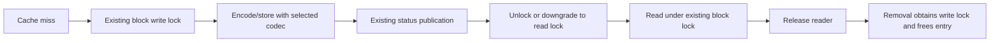

# Proposed SQL cache codec integration inside BlockManager

Status: READY FOR REVIEW — revised research proposal, not an accepted Spark API
or implementation. Revised 2026-10-22 after architect and independent review.
This is the long-term Apache Spark track. The short-term path continues to
target unmodified Spark; only isolated research overlays are authorized; no production Spark patch or external posting.

## Goals, in order

1. Bypass generic Java object serialization/deserialization of SQL cache data.
   A cache format such as Parquet should supply its own framed byte encoding
   without passing its bulk payload through ObjectOutputStream/ObjectInputStream.
2. Optionally avoid heap residency and bulk heap copies where practical.
   Native storage is a nice-to-have, not required for the codec goal.
   Codec work must remain independent of native implementation.
   A heap-backed implementation can meet goal 1 while still requiring heap
   sizing for its arrays and Spark's retained/unrolled values.
3. Reuse BlockManager's storage, locking, accounting, locations, replication,
   decommission, persistence levels and existing recovery.

This concerns SQL cache data IO. It does not replace task/closure serialization
or require that small RPC/control metadata avoid Java serialization. Existing
applications and cache implementations retain their current behavior unless
they opt into the new capability.

## Measured motivation and alternatives

The [six-batch reproduction](pcbs-six-batch-test.md) cached six measured
1,068,538,171-byte Parquet records per partition, about 95.54 GiB total.
With a 48 GiB local heap and eight task threads, both raw cache reload and full
SQL reads failed under default unroll checks. Changing Java stream reset alone
did not fix that workload; reducing the unroll check period too allowed it
to pass. These are synthetic local-mode observations, not production reliability
estimates. See the [investigation](pcbs-oom-investigation.md) for heap evidence.

The [split-budget comparison](pcbs-split-budget-sweep.md) shows that 16/32 MiB
records can pass that workload with default checks, but at different fill/read
times and GC behavior. Small cache records also reached the downstream GPU
aggregate without being coalesced back into large input batches. Those tests
do not prove one universal batch size safe across heap sizes and concurrency.

Therefore smaller records remain a mitigation, not something to dismiss.
The narrower upstream question is whether already encoded SQL records can use
a dedicated cache IO codec while retaining normal Spark storage and recovery.
The [native prototype](pcbs-shadow-payload-proof.md) separately supports the
memory benefit of keeping bulk data outside the heap. Neither observation
establishes the proposed integration.

A codec bypass alone does NOT promise the original heap OOM disappears: large
heap arrays and Spark's unroll retention may remain. Measure that separately.

## Reuse the existing BlockManager lifecycle

The reviewed Spark 3.5.5 paths already provide the relevant basic mechanisms:

| Requirement | Existing mechanism to retain |
| --- | --- |
| One local put at a time | doPut obtains lockNewBlockForWriting for the real block ID. |
| Publish completed data | Successful storage reports its status through the existing master; do not add a parallel publish directory. |
| Protect local readers | getLocalValues and local byte transfers acquire existing block read locks. |
| Retire stored data | removeBlock acquires the write lock and removes memory/disk entries. |
| Wait for readers | Successful blocking RDD removal waits for executor removals that acquire those write locks. |
| Locate and move copies | Existing block locations, transfer service, replication and decommission. |
| Recover missing data | Existing getOrCompute parent callback and genuine shuffle-fetch recovery. |

This diagram describes the successful existing path, not a new distributed
transaction. Partial puts, duplicate writers, cancellation and failures retain
Spark's current handling. The proposal adds no cache generations, commit grants,
retirement fences, parallel location service or task-yield protocol unless a
specific demonstrated gap later requires one.

Decisive source: BlockManager.scala doPut around 1500–1570, getLocalValues
around 929–995 and removeBlock around 2050–2095 in the inspected
[Spark 3.5.5 revision](https://github.com/apache/spark/blob/7c29c664cdc9321205a98a14858aaf8daaa19db2/core/src/main/scala/org/apache/spark/storage/BlockManager.scala).

## The narrow gap: cache-specific byte encoding

CachedBatchSerializer currently creates the SQL CachedBatch representation.
CachedRDDBuilder adds the statistics wrapper and persists that actual RDD.
The generic storage path then selects a serializer using ClassTag and the
application default. ClassTag[CachedBatch] does not identify the schema,
selected cache format or codec of an individual cache.

The smallest candidate is an OPTIONAL serializer/codec association on that
actual persisted cache RDD, retained with its BlockManager context. Prefer
adapting the existing Serializer/SerializerInstance streaming interfaces before
adding another codec abstraction. Its writeObject implementation would write
the cache format's framing and bytes directly, not delegate bulk data to Java
object serialization. Exact API names and whether the first public surface is
SQL-only or a generic per-RDD override remain design questions.

Conceptually:

1. SQL's selected cache-format implementation optionally supplies an immutable
   codec/factory and necessary schema/version context.
2. CachedRDDBuilder associates it with the actual persisted wrapper RDD.
3. BlockManager retains/resolves that context for the block's byte IO, including
   operations outside the originating task.
4. Absence of the association preserves current serializer selection.

This is a core-hook proposal, not a feature available through today's
CachedBatchSerializer. Setting a global custom spark.serializer for a test
would not prove per-cache selection or safe coexistence of multiple formats.

### Required call sites

| Path | What must use the same codec/context |
| --- | --- |
| Serialized memory unroll | MemoryStore.SerializedValuesHolder directly calls getSerializer; changing only SerializerManager.dataSerializeStream misses it. |
| Partial unroll / failed admission | Existing redirected stream, buffered prefix and uncached remainder must retain normal framing and ownership. |
| Disk population and memory-to-disk eviction | Existing dataSerializeStream must use the cache-specific encoding. |
| Serialized-memory and disk reads | Existing dataDeserializeStream must reconstruct the correct format. |
| Remote read / serving memory objects as bytes | Both requester decoding and sender encoding need the association. |
| Replica reception / decommission | A receiver without the original task must obtain the codec context before decoding or retaining the block. |

The proposal must explain how context reaches remote/replica receivers:
for example, an optional codec descriptor in existing block-transfer metadata,
or a self-describing stream envelope with an installed dispatcher. Neither is
selected yet. A task thread-local or an unextended ClassTag[CachedBatch] cannot
provide a receiver with per-cache codec context. The research carrier adds
that context; no public propagation API is selected.

Confidence F found a cleanup gap in the unreleased overlay: after first-action
take(1) or an injected decode exception, exact later reads passed, but one read
stream in each case lacked a successful close notification after the actions.
The snapshot precedes shutdown; this does not establish a permanent leak.
The existing iterator closes on EOF, which is insufficient for this contract.
Architect direction (2026-10-23): the codec's task-bound decoder streams use
the existing task-completion notification pattern and an idempotent close
guard; decode exceptions close immediately while preserving the original error.
A separate research follow-up passed both worker and independent root runs,
including early termination, failed-task retry, EOF/listener duplicate requests,
and explicit taskless caller/error cleanup. No new Spark cleanup protocol is
needed for these tested paths. Abandoned taskless BlockManager iterators and
replica receiver failures remain outside that bounded proof; caller ownership
there still needs explicit verification. This is a fixture, not a production fix.
Evidence and reproducible probe: [confidence results](pcbs-blockmanager-codec-spike.md#confidence-handoff-results).

Codec context must remain available for deferred eviction and existing readers.
Attach it to normal block/transfer ownership rather than retaining an RDD
strongly or inventing a separate payload-lifetime directory.

Current sources: [SerializerManager](https://github.com/apache/spark/blob/7c29c664cdc9321205a98a14858aaf8daaa19db2/core/src/main/scala/org/apache/spark/serializer/SerializerManager.scala),
[MemoryStore](https://github.com/apache/spark/blob/7c29c664cdc9321205a98a14858aaf8daaa19db2/core/src/main/scala/org/apache/spark/storage/memory/MemoryStore.scala),
and [NettyBlockTransferService](https://github.com/apache/spark/blob/7c29c664cdc9321205a98a14858aaf8daaa19db2/core/src/main/scala/org/apache/spark/network/netty/NettyBlockTransferService.scala).
The source-only call-site audit is retained at
/data/pcbs-oom/cache-codec-revision/findings.md.

## Optional native path: open design notes

Native payload storage is a nice-to-have (human decision, 2026-10-22), not a
codec requirement. No codec design, implementation or confidence gate depends
on native work. More native implementation is outside the current handoff.
If pursued later, payload allocation uses RAPIDS-managed spillable storage;
Spark's separately partitioned OFF_HEAP pool remains excluded.

- **Borrowed values:** deserialized entries return the cache-owned object.
  Iterator exhaustion releases the block read lock even when downstream code
  still holds the last batch; eviction/removal can then close its owner.
  Readers must take their own buffer reference while holding that lock.
  The fixture does so before release. No test yet uses a borrowed batch after its iterator releases
  the read lock during eviction/removal.
- **Accounting:** MemoryStore uses SizeEstimator over the reachable heap graph,
  not native payload bytes. The instrumented existing fixture recorded
  **197,480 Spark memory bytes for a 32,768-byte native payload**. After RAPIDS
  spilled it, Spark still reported 197,480 memory bytes, zero disk bytes and
  useMemory=true. Heap bookkeeping can exceed a small payload; this is not a
  native residency measurement. Open options are: charge an estimate of native
  size to Spark; charge wrapper/heap bookkeeping only and report native residency
  separately; or have Spark ask RAPIDS for residency. None is selected.
- **Allocation evidence:** the configured 64 MiB HostAlloc test rejects one
  individually over-limit request. It does not establish admission, aggregate
  residency or progress under memory pressure.
- **Heap IO:** payload IO is still heap-buffered. Whole-partition serialization
  for remote sends explicitly collects 4 MiB heap chunks. Direct BlockManager
  disk eviction instead calls buffered streaming IO; it does not allocate those
  4 MiB chunks through that path. Neither establishes heap-free transfers.

Measurement: /data/pcbs-oom/blockmanager-codec-confidence/docs-native-size/
accounting-measurement.json. This instruments the existing lifetime fixture
without introducing another native backend or pressure workload.

## Existing recovery and unpersist are the contract

On a cache miss, retain RDD.getOrCompute's computeOrReadCheckpoint callback.
If upstream shuffle outputs are gone, MapOutputTracker raises a real
MetadataFetchFailedException and Spark rebuilds the map stage and retries.
That is current recovery, not a fabricated cache exception.

The token [mechanism spike](pcbs-token-cache-spike.md) already demonstrated that
genuine recovery on Spark 3.5.5 and 4.0.1. Its result supports retaining the path;
it does not prove a new codec is integrated. No Deferred/resubmit task protocol
or failure-free recovery requirement is proposed.

Preserve unpersist(blocking=true)'s successful-path wait for block readers
through write-lock acquisition. Do not weaken it to logical removal plus a
report of outstanding readers. Also do not strengthen it into waiting for every
independent remote copy after transfer: transferred copies can have independent
ownership. Preserve existing timeout/failure reporting and nonblocking behavior.
Explicit unpersist and ContextCleaner continue through the same core removal
path; no new listener-based retirement protocol is needed upstream.

## Prior art: ExternalBlockStore and serialized OFF_HEAP

Spark 1.x had a configurable external-block-store backend, defaulting to Tachyon.
It was removed by [SPARK-12667 / PR 10752](https://github.com/apache/spark/commit/ad1503f92e1f6e960a24f9f5d36b1735d1f5073a)
on 2016-01-15. The commit documents limited use and preference for the standard
filesystem interface. It does not establish that native cache storage or a
cache-specific codec is inherently unsuitable.

[SPARK-13992 / PR 11805](https://github.com/apache/spark/commit/e41acb757327e3226ffe312766ec759c16616588)
subsequently added executor-local direct-buffer serialized caching on
2016-04-01. Its commit explicitly says the external API had already been removed
and OFF_HEAP had temporarily become an alias for MEMORY_ONLY_SER.
The new implementation added off-heap unroll/storage accounting and disposal;
it did not bypass object serialization.

The removed ExternalBlockManager's default value helpers and shipped Tachyon
backend used BlockManager serialization; configurable backends could override
those helpers. Tachyon's byte-read implementation allocated a whole-file
byte array. Reintroducing that API would therefore not directly solve the
primary codec goal. The later direct-buffer store is historical prior art,
not a candidate payload backend: its pool is separate from RAPIDS memory.
Reuse coordination and filesystem interfaces only where suitable. Do not attribute the earlier
removal to SPARK-13992 or infer an undocumented performance/lifetime failure.

Exact commit/source evidence is retained at
/data/pcbs-oom/external-block-store-history/manifest.json and findings.md.

## Focused prototype needed before upstream implementation

The BlockManager-integrated codec proof stands on its own; native work is optional.
It is distinct from the completed token/custom-RDD mechanism spike.

### A. Prove the primary codec goal, allowing heap storage

1. Associate a codec with a real SQL cache's actual persisted RDD. Instrument
   both the cache codec and generic Java/Kryo batch path; fail the test if the
   latter handles this cache's bulk records.
2. Exercise deserialized and serialized memory, disk population/eviction/reload,
   partial unroll and failed admission. A memory-only cache hit is insufficient.
3. Use multiple executor JVMs for remote fetch, replication and decommission.
   The receiving executor must decode without having run the producer task.
4. Run two caches with different schema/codec context concurrently, plus a normal
   RDD/default SQL cache. Their defaults and serializer selection must remain
   unchanged.
5. Verify exact rows, batches, encoded sizes, SQL statistics, empty partitions,
   genuine upstream-shuffle recovery and blocking unpersist with a paused reader.
6. Check the current supported Spark line and the intended upstream target.
   Preserve current partition-keyed/materialization semantics on newer Spark.

**Pass:** selected cache payloads never enter generic object serialization, all
byte IO routes use the same codec, and existing correctness/lifecycle/recovery
semantics remain. No claim of reduced total heap or solved heap OOM follows
automatically from this pass.

A prototype of the NEW core hook necessarily belongs in an isolated Spark
research branch. That is long-term upstream research, not a deployable
short-term fix or authorization to modify production Spark. A global custom
serializer test alone is only a preliminary codec experiment.

The bounded [BlockManager codec spike](pcbs-blockmanager-codec-spike.md) now
passes on Spark 3.5.5 and 4.0.1; a separate RAPIDS native lifetime fixture passes
on 3.5.5. These establish the recorded codec/ownership mechanisms, not the full
native storage API or all criteria above. Full accounting, bounded transfers
and native failure paths remain open. Existing large PCBS and token proofs
remain useful controls and need not be repeated wholesale.

## Upstream plan and decisions

1. Review this narrower problem, measurements, prior art and call-site inventory.
2. Build the focused core-hook prototype and use its failures to choose the
   smallest API. Keep format selection separate from storage placement.
3. Prepare an Apache SPIP/design discussion if the community considers the change
   sufficiently cross-cutting. Include the default path, compatibility,
   persistence levels and measured heap/performance effects.
4. Implement and test codec-context integration independently. Optional native
   work requires its own design and authorization; it is not an upstream codec gate.
5. Do not freeze the unreleased ClassTag/token research carriers as public contracts.

The [official SPIP guidance](https://spark.apache.org/improvement-proposals.html)
and [contributor process](https://spark.apache.org/contributing.html) govern any
future public proposal. No issue, mailing-list message or PR is authorized or
posted here. API acceptance and the estimated five-year rollout are not promised.

Open codec decisions are where to attach per-cache context, how to propagate
it to receivers and how unsupported combinations fall back or fail without
silently changing released behavior. The spike carried the codec inside ClassTag,
Java-serialized in the task binary and replica-upload metadata. ClassTag equality
ignores the codec, so it cannot key a per-codec directory. This supports the
descriptor-in-existing-transfer-metadata option; it is evidence, not a recommended
ClassTag API. Optional native ownership/accounting decisions are separate notes
above and do not gate codec acceptance. No provider-owned driver publication API
or new cache recovery protocol remains.

## Status and compatibility

Existing Spark SQL/cache/serializer/StorageLevel behavior is RELEASED and must
be preserved by default. The proposed hook and local prototype are UNRELEASED:
obsolete sketches can be replaced directly without compatibility adapters.
The previous driver/provider commit protocol and Deferred task mechanism are
removed from this proposal, not retained as alternate requirements.

The API remains a proposal. Bounded compiled research overlays and native
lifetime fixtures are recorded separately; they do not establish production
integration or a complete native backend. The companion
[version audit and token results](pcbs-token-cache-spike.md) retain their own
scope; the newer codec runtime results cover 3.5.5 and 4.0.1 only.
