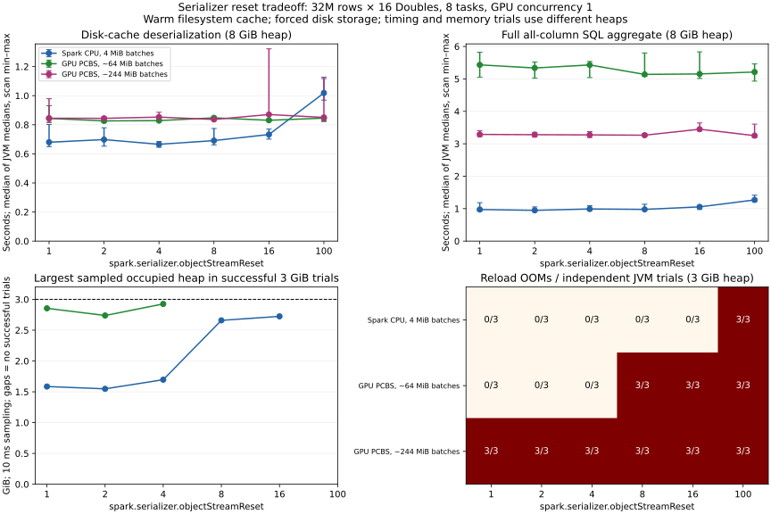

# Serializer reset performance and heap sweep

Status: READY FOR REVIEW. No production code changed.

Tested Spark 3.5.5 / Java 17 on the RTX A6000 host using the existing plugin
artifact reporting source revision 3cdf711ded (SHA-256 below). Reset intervals: 1, 2, 4, 8, 16, 100.
Each job used 32M rows, 16 seeded random Double columns, eight partitions/tasks,
and GPU concurrency 1 where applicable. The raw payload is 4.096 GB (~3.8 GiB).

## Findings

Across 84 fresh JVMs, lowering the reset interval reduced heap failures without
large read-time changes for PCBS in this workload. Reset 1 versus 100 gave:

- With ~64 MiB PCBS batches, raw reload time changed by -0.2%, the full SQL
  aggregate took 4.2% longer, and cache population took 3.7% longer.
- With ~244 MiB PCBS batches, raw reload time changed by -0.7%, the SQL aggregate
  took 1.2% longer, and population took 3.6% longer.
- With Spark's default CPU serializer, reloads were 33.2% faster and the SQL
  aggregate was 23.3% faster. Population was 6.8% faster.

The PCBS endpoint timing ranges overlap across fresh JVMs. These results put the
observed cost in the low single digits for this workload; they do not establish
an exact penalty or a general zero-cost setting. Serialized disk size changed by
less than 0.013% in all three modes.

At 3 GiB, ~64 MiB PCBS batches passed all three trials at reset 1, 2 and 4,
and failed all three at 8, 16 and 100. The ~244 MiB batches failed all trials,
including reset 1. Reset 1 therefore helps with stream retention but cannot
ensure that eight concurrent readers fit in the heap. CPU batches passed all
trials through reset 16 and failed all trials at 100. Among successful CPU
reloads, maximum sampled occupied heap rose from about 1.6 GiB at reset 1 to
2.7 GiB at reset 16; these measurements include garbage awaiting collection.

There is also a batch-size tradeoff: at reset 100 the SQL aggregate took 5.21 s
with ~64 MiB PCBS batches versus 3.25 s with ~244 MiB batches. The smaller
batches were about 60% slower here. This is a single GPU-concurrency-1 workload,
so it does not establish a production batch-size recommendation.

## Timing and failures

Each timing JVM makes five scans after a warmup, with 8 GiB heap. Reset 1 and
100 have three independent JVMs each; other intervals have one. Tables use the
median of the per-JVM medians.
Failure counts come from three independent 3 GiB JVMs, each attempting a warmup
and two further reloads. The timing and pressure measurements use different heaps.

| Serializer / batches | Reset | Deserialize, ms | SQL aggregate, ms | SQL change vs 100 | Reload OOMs, 3 GiB |
| --- | ---: | ---: | ---: | ---: | ---: |
| Spark CPU, 4 MiB batches | 1 | 680 | 974 | -23.3% | 0/3 |
| Spark CPU, 4 MiB batches | 2 | 698 | 948 | -25.3% | 0/3 |
| Spark CPU, 4 MiB batches | 4 | 666 | 990 | -22.0% | 0/3 |
| Spark CPU, 4 MiB batches | 8 | 691 | 977 | -23.0% | 0/3 |
| Spark CPU, 4 MiB batches | 16 | 733 | 1055 | -16.9% | 0/3 |
| Spark CPU, 4 MiB batches | 100 | 1018 | 1269 | +0.0% | 3/3 |
| GPU PCBS, ~64 MiB batches | 1 | 844 | 5432 | +4.2% | 0/3 |
| GPU PCBS, ~64 MiB batches | 2 | 827 | 5337 | +2.4% | 0/3 |
| GPU PCBS, ~64 MiB batches | 4 | 829 | 5430 | +4.2% | 0/3 |
| GPU PCBS, ~64 MiB batches | 8 | 848 | 5139 | -1.4% | 3/3 |
| GPU PCBS, ~64 MiB batches | 16 | 831 | 5153 | -1.1% | 3/3 |
| GPU PCBS, ~64 MiB batches | 100 | 846 | 5212 | +0.0% | 3/3 |
| GPU PCBS, ~244 MiB batches | 1 | 845 | 3289 | +1.2% | 3/3 |
| GPU PCBS, ~244 MiB batches | 2 | 844 | 3280 | +0.9% | 3/3 |
| GPU PCBS, ~244 MiB batches | 4 | 853 | 3274 | +0.7% | 3/3 |
| GPU PCBS, ~244 MiB batches | 8 | 836 | 3264 | +0.4% | 3/3 |
| GPU PCBS, ~244 MiB batches | 16 | 870 | 3449 | +6.1% | 3/3 |
| GPU PCBS, ~244 MiB batches | 100 | 850 | 3251 | +0.0% | 3/3 |

## Cache population and serialized size

Population includes generation, encoding and explicit GC between partitions.
It does not isolate Java serialization cost. Values are medians of three JVMs.

| Serializer / batches | Populate reset 1, s | Populate reset 100, s | Change | Disk byte change |
| --- | ---: | ---: | ---: | ---: |
| Spark CPU, 4 MiB batches | 17.17 | 18.43 | -6.8% | +0.01212% |
| GPU PCBS, ~64 MiB batches | 16.96 | 16.35 | +3.7% | +0.00014% |
| GPU PCBS, ~244 MiB batches | 15.75 | 15.20 | +3.6% | +0.00002% |



## Measurement limits

- These are local-mode, warm filesystem-cache measurements of one generated
  incompressible numeric workload. They are not production failure probabilities.
- Memory fraction 0.03 forces every partition to disk under both heap sizes.
  Every population and scan asserts eight cached partitions, positive disk bytes
  and zero cached memory. This differs from the initial reproduction fraction 0.15.
- Deserialization collects only row counts from the actual cached RDD. Full SQL
  scans sum every column. Every SQL iteration creates a fresh execution and
  verifies that its cache scan output metric is exactly 32M rows.
- SQL runs follow deserialization warmup. Explicit GC precedes every timed scan
  outside its timing. Population timing includes generation, encoding and the
  explicit GC between partitions; it does not isolate serialization CPU cost.
- Five scans share each timing JVM. Endpoints have three JVMs; intermediate
  intervals have one. Small differences can still reflect run-to-run variation.
- Heap sampling is every 10 ms and measures occupied heap, not retained/live data
  or RSS. GC-log after-pause values can include dead objects and cover young,
  remark and cleanup pauses. They are also occupied heap, not measured live data.
- Successful JVMs require exit zero, completion, exact phase counts and SQL
  scan counts. OOMs require nonzero exit, no timeout, explicit Java heap OOM
  and a reload-phase failure. Population or SQL errors park the runner.
- This does not establish the cost of changing this setting for other Java
  serialization workloads, especially workloads containing many small objects.

## Reproduce and evidence

The standalone source is [CacheReloadBench.scala](../../tools/CacheReloadBench.scala).
The source hash below records its version at commit `ca8cb52e14`, before the
later mixed-cache telemetry extension; the archived benchmark jar is unchanged.
Compile it against the Spark runtime jars, package the resulting classes and
run with spark-submit. Exact per-run argv, environment overrides, JVM and GC logs,
manifest and raw JSONL metrics are under `/data/pcbs-oom/sweep/`.
The supervisor is `run_sweep.py`; the analysis scripts are `analyze.py` and `plot.py`.

```sh
java -cp "/home/roberte/src/spark_3.5.5/assembly/target/scala-2.12/jars/*" \
  scala.tools.nsc.Main -usejavacp -d /data/pcbs-oom/sweep/classes \
  tools/CacheReloadBench.scala
jar cf /data/pcbs-oom/sweep/cache-reload-bench.jar \
  -C /data/pcbs-oom/sweep/classes .
```

Example GPU64 timing job after compilation (run from the repository root):

```sh
CACHE_SQL=true CACHE_ITERATIONS=5 \
/home/roberte/src/spark_3.5.5/bin/spark-submit \
  --class CacheReloadBench --master 'local[8]' --driver-memory 8g \
  --jars dist/target/rapids-4-spark_2.12-26.12.0-SNAPSHOT-cuda12.jar \
  --conf spark.sql.adaptive.enabled=false \
  --conf spark.memory.fraction=0.03 \
  --conf spark.serializer.objectStreamReset=1 \
  --conf spark.sql.inMemoryColumnarStorage.batchSize=100000 \
  --conf spark.local.dir=/data/pcbs-oom/sweep/manual-local \
  --conf spark.plugins=com.nvidia.spark.SQLPlugin \
  --conf spark.sql.cache.serializer=com.nvidia.spark.ParquetCachedBatchSerializer \
  --conf spark.rapids.sql.enabled=true \
  --conf spark.rapids.sql.metrics.level=DEBUG \
  --conf spark.rapids.sql.exec.InMemoryTableScanExec=true \
  --conf spark.rapids.sql.concurrentGpuTasks=1 \
  --conf spark.rapids.memory.gpu.allocSize=2g \
  --conf spark.rapids.memory.gpu.maxAllocSize=8g \
  --conf spark.rapids.sql.batchSizeBytes=67108864 \
  /data/pcbs-oom/sweep/cache-reload-bench.jar
```

For the pressure runs use 3g, CACHE_SQL=false and CACHE_ITERATIONS=2. For GPU256
use batchSizeBytes=268435456. For CPU omit the plugin jar and RAPIDS settings,
set spark.plugins to empty and set spark.sql.cache.serializer to
org.apache.spark.sql.execution.columnar.DefaultCachedBatchSerializer.
Each invocation must use a fresh JVM. Raw run commands additionally enable GC
logging with spark.driver.extraJavaOptions; see the saved command JSON files.

Artifact SHA-256:

- Source: `77e5dfcd526024efbedd034d3980dd898e4063865ae2c6cf4fa61b0f375f6e4f`
- Benchmark jar: `8e2c793c1971ade74813be1082cf4ded913b247197a00dc82a67f71d47da33f6`
- Plugin jar: `f3bc760d51c1c8596ac9108242f2c9366f570d7b5612a1239aba88e73ee25af5`

[Summary CSV](pcbs-reset-sweep-summary.csv) includes timing ranges, GC time,
occupied heap measurements and serialized disk bytes. The
[JVM outcomes CSV](pcbs-reset-sweep-outcomes.csv) records all 84 job outcomes.
[Phase CSV](pcbs-reset-sweep-phases.csv) retains individual measurements.

Independent review checked the benchmark, failure classification and analysis;
recomputed representative medians and verified six real 32M-row SQL scans.
No production fix or global configuration change is proposed by this report.
